# Deskcraft: Three-Tier Shopping Application on AWS

A production-style, multi-AZ **three-tier web application** built and deployed by hand on AWS. A React storefront is served from **S3 + CloudFront**, API traffic flows through an **Nginx web tier** and a **Node.js app tier** (each on its own Auto Scaling Group behind a load balancer), data lives in **RDS MySQL** and **DynamoDB**, and customer emails are sent by an **event-driven Lambda + SNS** pipeline.


> **Project status:** fully deployed and tested end to end in `ap-south-1` (Mumbai). The stack is torn down between sessions to keep costs near zero, so there is no permanent live URL. The screenshots below are from the running deployment.

## Table of contents
1. [Architecture](#1-architecture)
2. [Why this design](#2-why-this-design)
3. [AWS services used](#3-aws-services-used)
4. [Tech stack and repository layout](#4-tech-stack-and-repository-layout)
5. [Application features](#5-application-features)
6. [Deployment walkthrough](#6-deployment-walkthrough)
7. [Testing the application](#7-testing-the-application)
8. [Security](#8-security)
9. [Monitoring and auditing](#9-monitoring-and-auditing)
10. [Problems I solved](#10-problems-i-solved)
11. [Cost and clean-up](#11-cost-and-clean-up)
12. [Future improvements](#12-future-improvements)
13. [Run it locally](#13-run-it-locally)
14. [Author](#14-author)

---

## 1. Architecture

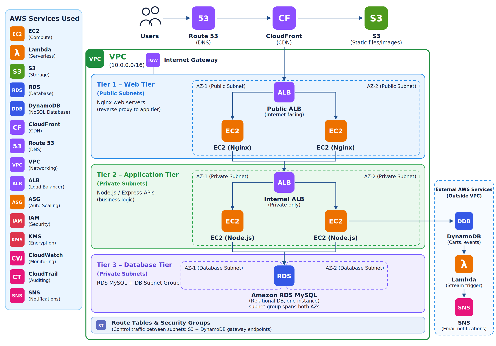

**Request flows**

| Flow | Path |
|---|---|
| **Page load** | Browser → CloudFront → S3 (React build, product images). No server is involved. |
| **API call** (for example `/api/products`) | Browser → CloudFront → public ALB → Nginx web tier → internal ALB → Node.js app tier → RDS / DynamoDB |
| **Place order** | Node.js saves the order in RDS (one transaction), deletes the cart, and writes an event row to DynamoDB. The **DynamoDB Stream** triggers **Lambda**, which sends the customer's email through **SNS**. |

CloudFront has two origins: the **S3 bucket** (default behavior) and the **public ALB** (`/api/*` behavior). Because the page and the API share one domain, no CORS configuration is needed.

## 2. Why this design

| Layer | What it does | Why it is a separate layer |
|---|---|---|
| **S3 + CloudFront** | Hosts the React build and product images; CloudFront caches them at the edge and serves HTTPS | Static files need no server. S3 is cheap, durable and scales automatically, so EC2 capacity is never spent on images or JavaScript. |
| **Web tier (Nginx, ASG)** | The only tier the internet reaches. Rate-limits requests, adds security headers, limits request size, returns 404 for unknown paths and forwards `/api` to the internal ALB | It is a shield in front of the business logic: abusive traffic stops here, and the app servers never need a public address. |
| **App tier (Node.js/Express, ASG)** | Registration, login (bcrypt + JWT), products, cart, orders. Holds the database access and secrets | Private subnets only. It can be reached solely from the internal ALB, so it is scaled and released independently of the web tier. |
| **RDS MySQL** | Users, products, orders (transactions, relationships) | Relational data that needs ACID guarantees. |
| **DynamoDB** | Shopping carts and the event table | Simple, frequent key lookups with no capacity planning. The event table's stream drives the email pipeline. |
| **Lambda + SNS** | Sends the confirmation emails | Slow work happens outside the request, so checkout never waits for email and an email failure never breaks an order. |
| **Two ALBs + two ASGs** | Spread traffic across two Availability Zones and replace failed instances | No tier has a single point of failure. |

## 3. AWS services used

| Service | Purpose in this project |
|---|---|
| **VPC** (6 subnets, 2 AZs, route tables, Internet Gateway) | Network isolation: public web subnets, private app subnets, private database subnets |
| **VPC gateway endpoints** (S3, DynamoDB) | Lets the private app tier reach S3 and DynamoDB without a NAT Gateway (free) |
| **EC2 + Launch Templates + Auto Scaling** | Web tier (Nginx) and app tier (Node.js), 2 to 4 instances each, health checks via the load balancer |
| **Application Load Balancers** (public and internal) | Entry point to the web tier, and a private entry point to the app tier |
| **CloudFront + S3 (Origin Access Control)** | Global CDN for the frontend; the bucket stays private |
| **RDS (MySQL)** | Relational data in private database subnets, encrypted |
| **DynamoDB** (+ Streams, TTL) | Carts and events; the stream triggers Lambda; TTL expires old events |
| **Lambda + SNS** | Event-driven email notifications |
| **IAM** | One least-privilege role per tier, no access keys on servers |
| **Security groups** | A chain where each layer accepts traffic only from the layer in front of it |
| **CloudTrail, CloudWatch, SNS alerts** | Auditing and alerting |
| **Route 53** | Optional: custom domain (the deployment uses the CloudFront domain) |

## 4. Tech stack and repository layout

**Frontend:** React 18 + Vite  **Backend:** Node.js, Express, `mysql2`, AWS SDK v3, bcryptjs, jsonwebtoken  **Web server:** Nginx  **Database:** MySQL 8 (RDS), DynamoDB  **Serverless:** Lambda (Node.js, ES modules)

```
.
├── frontend/             React app (built and uploaded to S3)
├── web-tier/nginx.conf   Nginx config: rate limiting, security headers, /api reverse proxy
├── app-tier/             Node.js API (index.js, DbConfig.js, AwsClients.js)
├── lambda/index.mjs      DynamoDB-stream-triggered notification function (SNS)
├── database/schema.sql   MySQL tables and sample products
├── deploy/               Launch Template user data and packaging/upload scripts
└── docs/images/          Screenshots used in this README
```

## 5. Application features

- Create an account and log in (bcrypt password hashing, JWT sessions)
- Browse products (images served from S3 through CloudFront)
- Cart stored in DynamoDB, so it persists across sessions
- Place an order: prices are always read from MySQL on the server, and the order is saved in a database transaction
- Email notifications: a subscription-confirmation email after sign-up, and an order-confirmation email after each purchase

## 6. Deployment walkthrough

Everything was created in the AWS console in `ap-south-1`. The build order is bottom-up: network → data → event pipeline → app tier → web tier → CloudFront → hardening. Each step was tested before the next one.

### 6.1 Network (VPC)
Created with the **VPC and more** wizard: 2 AZs, 2 public subnets, 4 private subnets (app and database), route tables and an Internet Gateway.

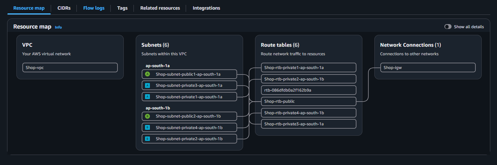

### 6.2 Security group chain
Each layer accepts traffic only from the layer in front of it:

| Security group | Inbound |
|---|---|
| Public ALB | HTTP/HTTPS from the internet (later restricted to CloudFront) |
| Web tier | HTTP from the public ALB only |
| Internal ALB | HTTP from the web tier only |
| App tier | TCP 4000 from the internal ALB only |
| RDS | MySQL 3306 from the app tier only |

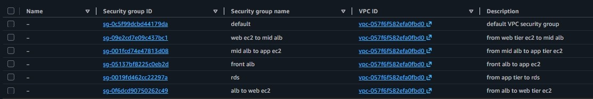

### 6.3 Data layer
**RDS MySQL** in private database subnets (not publicly accessible, encrypted):

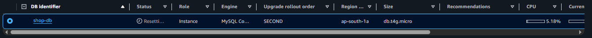

**DynamoDB** tables `shop-carts` (partition key `userId`) and `shop-events` (partition key `id`), both on-demand. `shop-events` has **Streams (new image)** enabled and **TTL** on the `expiresAt` attribute:

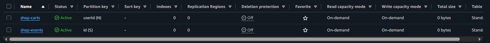
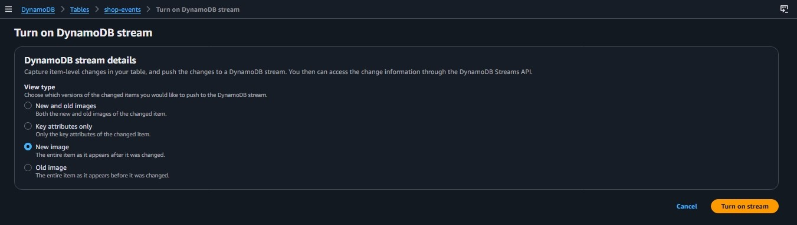

### 6.4 Event pipeline: SNS and Lambda
SNS topic `shop-emails`, then the Lambda function `shop-notifier`:

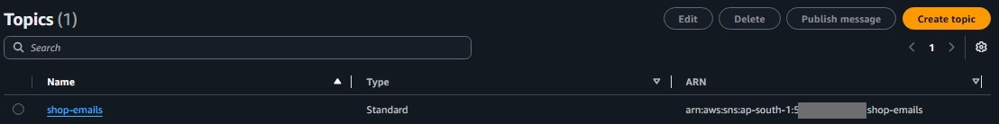
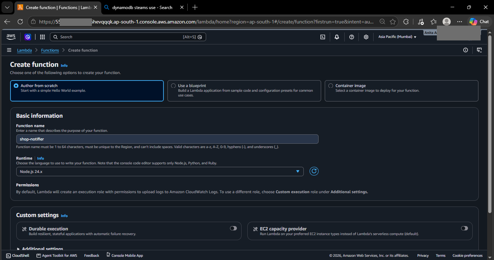

Environment variables (`TOPIC_ARN`, `EVENTS_TABLE`) keep configuration out of the code:

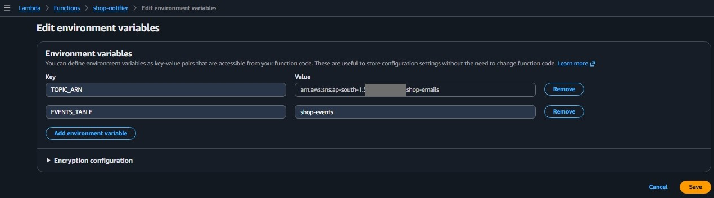

The function's role has the managed `AWSLambdaDynamoDBExecutionRole` plus a small inline policy for SNS publish/subscribe and `dynamodb:UpdateItem`:

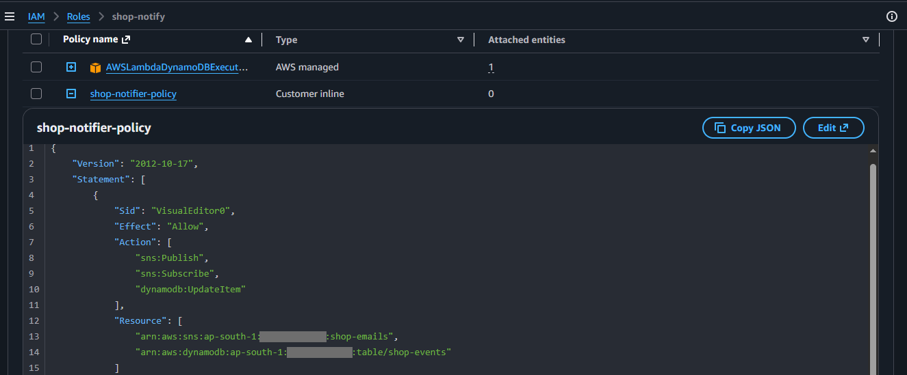

The DynamoDB stream is the trigger (batch size 10, starting position *Latest*):

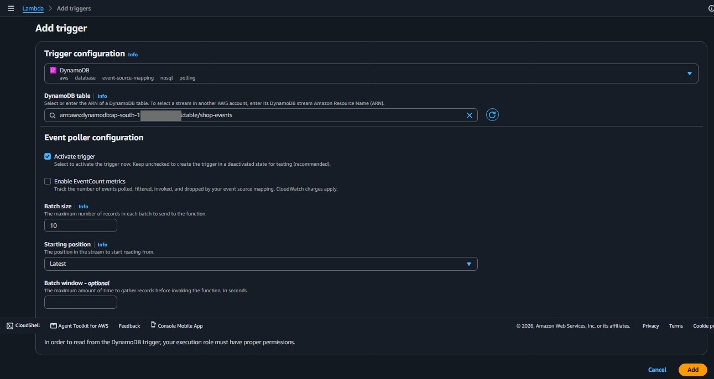

**How the emails work.** On sign-up, the Lambda subscribes the customer's email to the SNS topic with a *filter policy*, so each customer only receives messages addressed to them. SNS sends a one-time "Confirm subscription" email. Order confirmations are published with an `email` message attribute that matches that filter. (For a production system I would use Amazon SES, which can email any address without a confirmation step.)

### 6.5 IAM roles for the servers
One least-privilege role per tier. The app tier can read its code package from S3 and read/write the two DynamoDB tables; the web tier can only read its Nginx config from S3.

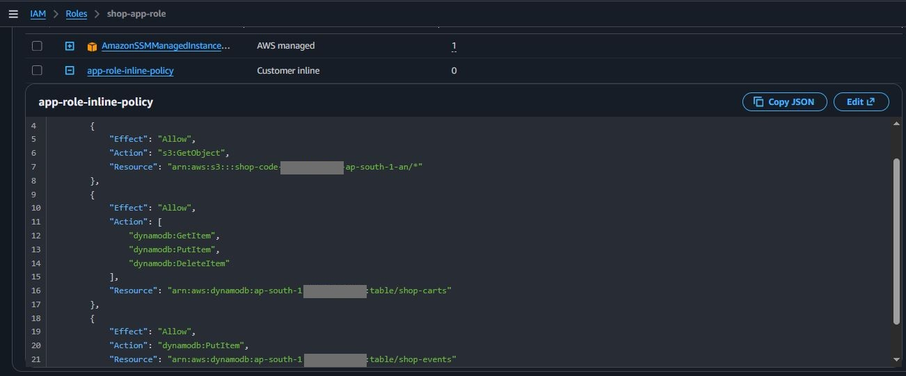
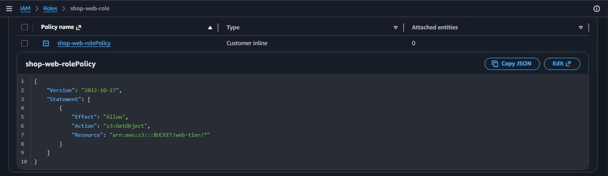

### 6.6 S3 buckets
- **Site bucket** (private): the React build and product images, read only by CloudFront through Origin Access Control.
- **Code bucket** (private): the packaged app tier (`app-tier.tar.gz`), `schema.sql` and `web-tier/nginx.conf`, downloaded by the instances at boot.

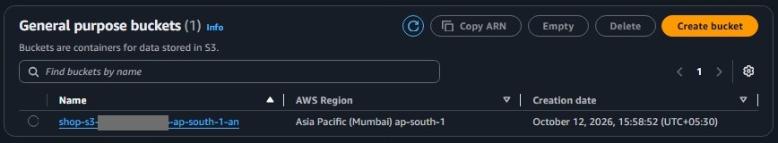
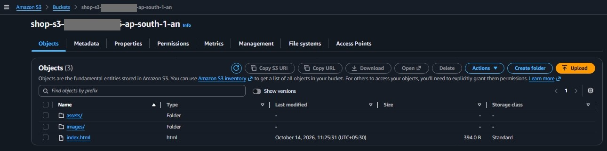
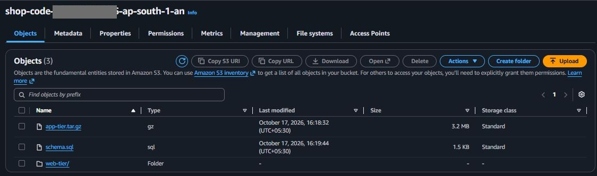

### 6.7 VPC gateway endpoints (no NAT Gateway)
The app tier has no route to the internet. The free **S3 and DynamoDB gateway endpoints**, attached to the private route tables, let it download packages and code from S3 and use DynamoDB privately.

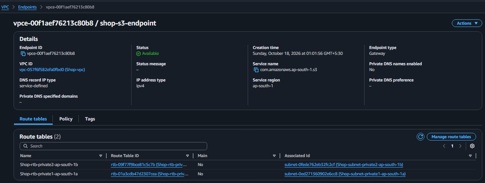
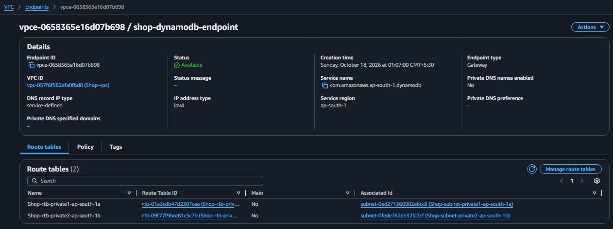

### 6.8 App tier: Launch Template, internal ALB, Auto Scaling Group
The Launch Template (Amazon Linux 2023, no public IP, tier IAM role) boots the Node.js API via user data (`deploy/app-tier-userdata.sh`) as a `systemd` service on port 4000. The **internal** ALB forwards to a target group with health check `/health`. The ASG runs 2 to 4 instances across both AZs, with ELB health checks.

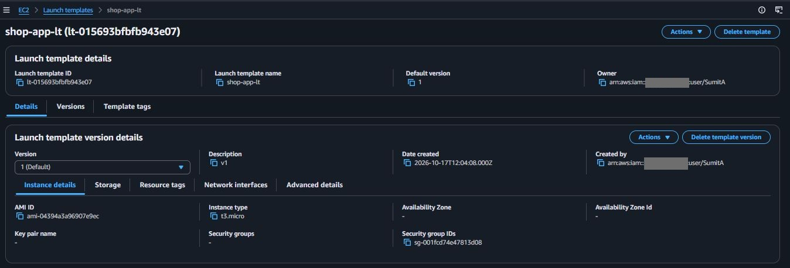
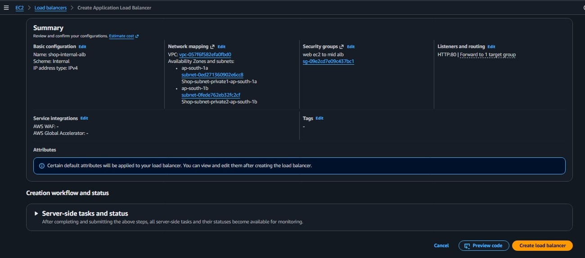
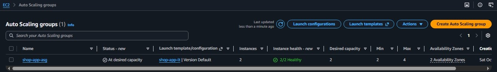

### 6.9 Web tier: Nginx, public ALB, Auto Scaling Group
Nginx (`web-tier/nginx.conf`) rate-limits to 10 requests per second per client IP, adds security headers, limits request bodies to 1 MB, answers `/health`, returns 404 for everything except `/api`, and forwards `/api/` to the internal ALB. The web tier sits in public subnets behind the **internet-facing** ALB. Public subnets must auto-assign public IPv4 addresses, or the instances cannot install Nginx:

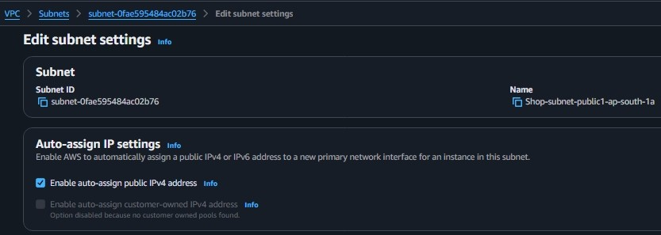

### 6.10 CloudFront
One distribution, two origins:
- **S3 origin** (default behavior, `index.html` as the default root object), accessed through Origin Access Control.
- **Public ALB origin**, with a `/api/*` behavior: all HTTP methods, caching disabled, and the `AllViewerExceptHostHeader` origin request policy so the login `Authorization` header is forwarded.

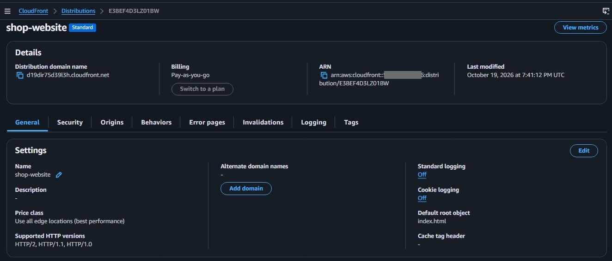
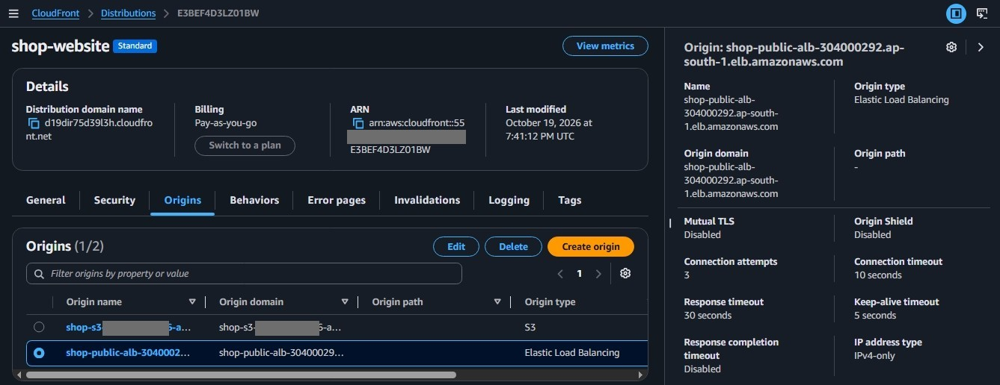
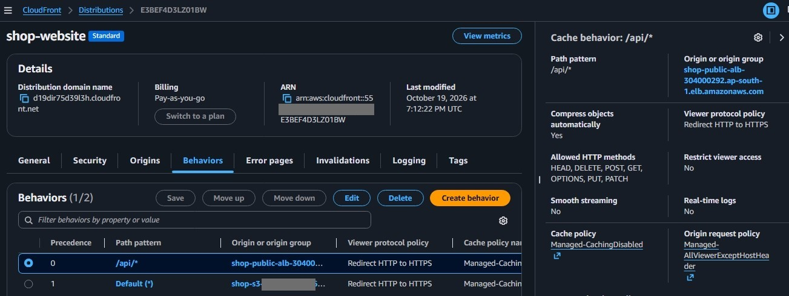

## 7. Testing the application

**Storefront served through CloudFront**

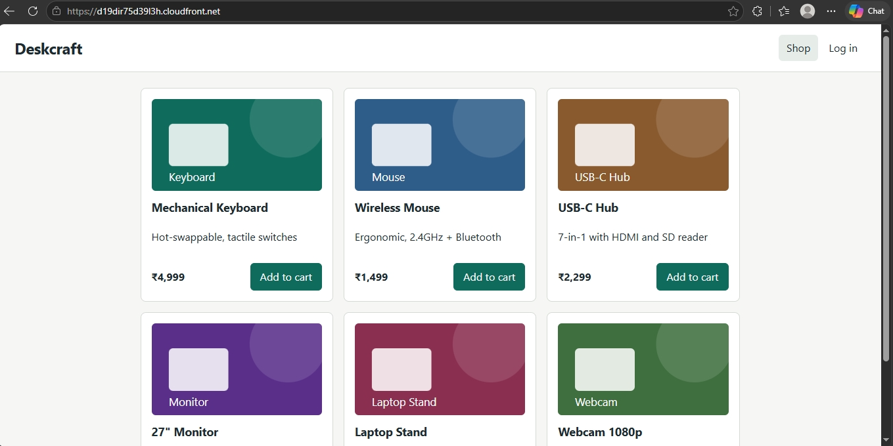

**1. Create an account**

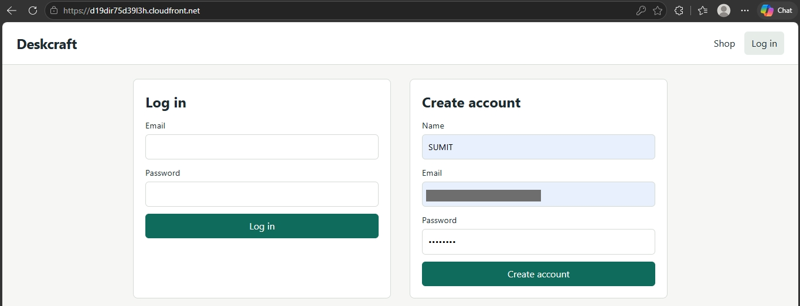

**2. SNS sends the subscription confirmation email; confirm it**

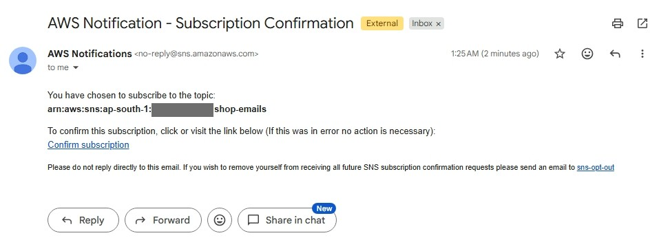
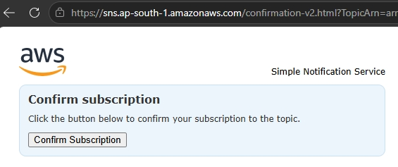
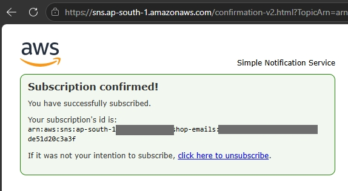

**3. Add products to the cart and place an order**

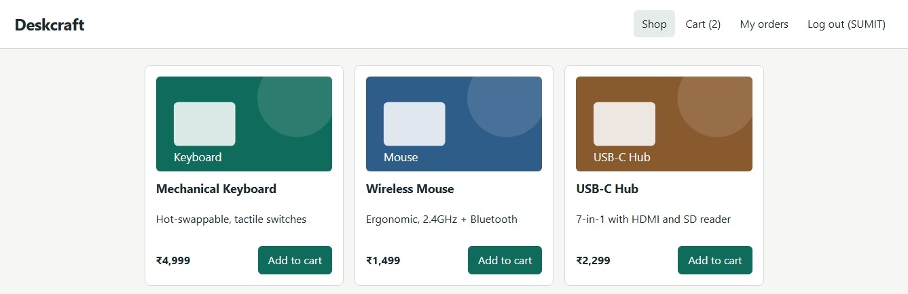
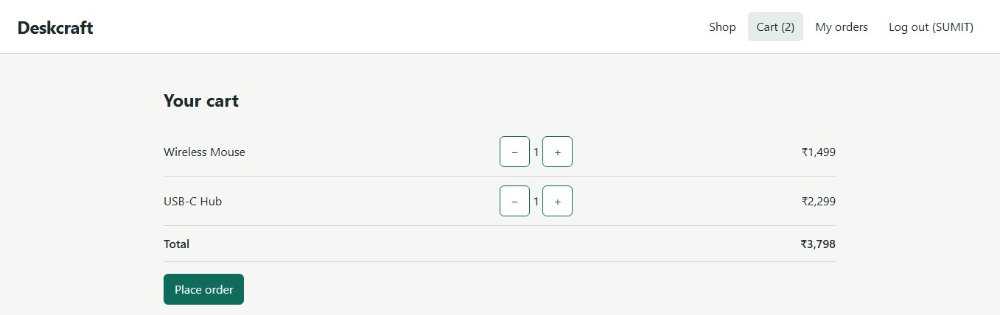

**4. The order confirmation email arrives (DynamoDB Stream → Lambda → SNS)**

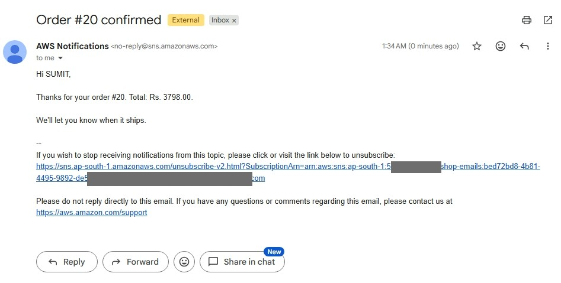

## 8. Security

| Control | How it is implemented |
|---|---|
| **Network isolation** | App and database tiers in private subnets; RDS not publicly accessible; no NAT Gateway and no inbound path from the internet to the app tier |
| **Layered firewalls** | Chained security groups: each tier trusts only the tier in front of it |
| **Least-privilege IAM** | One role per tier, scoped to specific buckets, tables and actions; no access keys on any server |
| **Locked-down origin** | The public ALB only accepts traffic from CloudFront (managed prefix list), and a **secret header** (`X-Origin-Verify`) is verified by an ALB listener rule. Anything without it receives `403`, so other CloudFront distributions or direct calls cannot bypass CloudFront. |
| **IMDSv2 required** | Launch Templates enforce token-based instance metadata, which blocks credential theft through SSRF |
| **Encryption** | RDS, S3 and DynamoDB encrypted at rest; HTTPS between users and CloudFront |
| **Private S3** | Block Public Access stays on; CloudFront reads through Origin Access Control |
| **Application security** | bcrypt password hashing, JWT auth, parameterised SQL, prices always read from the database, rate limiting and request-size limits at Nginx |

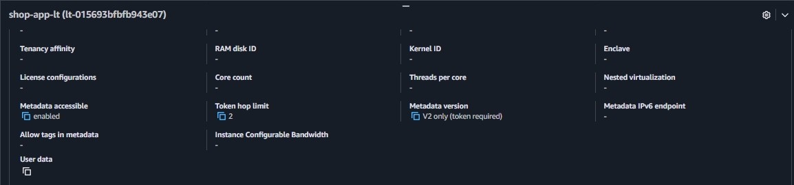
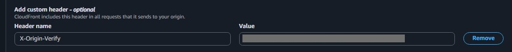
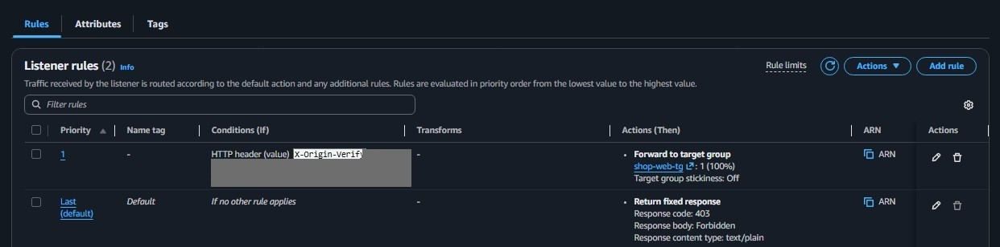

The listener has a rule that forwards to the web target group only when the `X-Origin-Verify` header matches, and a default action that returns a fixed `403 Forbidden` response. (The secret value is blacked out in these screenshots.)

## 9. Monitoring and auditing

- **CloudTrail:** a multi-region trail logs all management events to S3 for auditing.
- **Alerting:** an SNS topic (`shop-alerts`) with a confirmed email subscription receives CloudWatch alarm notifications.
- **Health checks:** both ALBs probe `/health` on every instance, and the ASGs replace any instance that fails.
- **Logs:** Lambda writes to CloudWatch Logs; Nginx access logs include the real client IP.

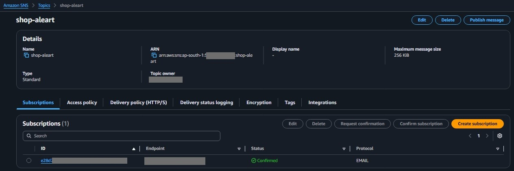
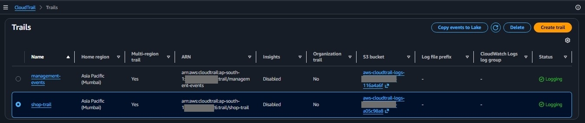

**Recommended CloudWatch alarms** (to notify the alert topic): ALB `HTTPCode_Target_5XX_Count`, `UnHealthyHostCount` per target group, `TargetResponseTime`, ASG CPU, RDS CPU and `FreeStorageSpace`, Lambda `Errors` and `IteratorAge`.

## 10. Problems I solved

These are the real issues I hit while building the stack, and how I diagnosed them:

| Symptom | Root cause | Fix |
|---|---|---|
| Web target group unhealthy, Nginx never installed | Public-subnet instances had no public IPv4, so `dnf` could not download anything | Enabled auto-assign public IPv4 on the public subnets and replaced the instances |
| App instances failed to boot: `dnf` and package downloads timed out | The private subnets had no route to S3 (where the Amazon Linux repositories and my code live) and no NAT Gateway | Added free **S3 and DynamoDB gateway endpoints** to the private route tables |
| `504` from the API, then `502` | A security group in the chain did not allow the next hop (port 4000 from the internal ALB), then the app process was not running | Walked the chain hop by hop with `curl` from inside the VPC, fixed the rule, and read the service logs |
| `{"error":"Something went wrong"}` | `DB_NAME` was set to the RDS **instance identifier** instead of the database name (`shop`) | Corrected it in the Launch Template user data and rolled the ASG |
| Lambda "Function call failed" | JavaScript syntax mistake: `process.env.<value>` instead of reading the variable by name | Used environment variables (`TOPIC_ARN`, `EVENTS_TABLE`) |
| `Cannot GET /api/*/api/products` | The CloudFront ALB origin had an **origin path**; CloudFront prepends it to every request | Cleared the origin path, since the `/api/*` pattern belongs only to the behavior |
| API broke after recreating the load balancers | New ALBs get new DNS names | Updated the Nginx upstream name in the Launch Template and the CloudFront origin |
| CloudFront distribution blocked on a new account | Account verification required | Opened an AWS Support case, and tested the full stack in the meantime by proxying the API locally |

## 11. Cost and clean-up

The always-on costs are the two ALBs, the EC2 instances (and public IPv4 addresses on the web tier) and RDS. DynamoDB, Lambda, SNS, S3, CloudFront and the VPC endpoints are effectively free at this scale. To pause: set both ASG desired capacities to 0 and stop RDS. To stop all charges, delete the ALBs, ASGs, RDS, endpoints and buckets. Load balancers bill hourly even with zero targets.

## 12. Future improvements

- Infrastructure as code (Terraform or CloudFormation) and a CI/CD pipeline
- Custom domain with Route 53 and an ACM certificate, with HTTPS on the ALB origin
- AWS WAF managed rules on CloudFront
- Secrets Manager or Parameter Store instead of values in user data
- Amazon SES for transactional email; CloudWatch dashboards and alarms for every tier
- Containerise the app tier (ECS Fargate) and add RDS Multi-AZ

## 13. Run it locally

```bash
# 1. Database: run database/schema.sql in a local MySQL
# 2. API
cd app-tier && cp .env.example .env     # fill in the values
npm install && npm start                # listens on :4000
# 3. Frontend (proxies /api to :4000)
cd frontend && npm install && npm run dev   # http://localhost:5173
```
The cart and email features use real DynamoDB, Lambda and SNS resources, so they need your AWS credentials and the tables from the walkthrough.

## 14. Author

**Sumit**: IT Infrastructure and Cloud (AWS)
[GitHub](https://github.com/sumit-adkhale) · [LinkedIn](https://linkedin.com/in/sumit-adkhale/)
